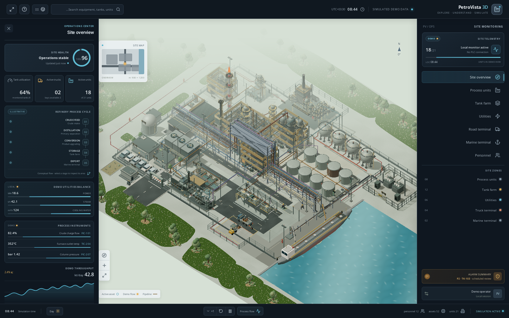

<div align="center">
  <h1>PetroVista 3D</h1>
  <p><strong>Explore. Understand. Simulate.</strong><br />An interactive, bilingual 3D refinery and export-terminal demonstration.</p>
  <p><a href="#english">English</a> · <a href="#persian">فارسی</a></p>
  <p>
    
    
    
    
  </p>
</div>

<a id="english"></a>

## English

# From crude oil to products: a refinery, explained

PetroVista 3D is a browser-based, interactive model of a refinery campus and export terminal. This article follows the process route represented in the scene, explains why the major units are connected, and turns well-documented industry evidence into a practical improvement agenda. It is an educational guide—not an operating manual.

> **Important boundary:** PetroVista is a visual demonstration, not a refinery, digital twin, process simulator, engineering design, or safety system. Its capacities, measurements, conditions, equipment arrangement, route links, and activities are invented demo values. There is no live telemetry, PLC connection, backend, or external API. Nothing on screen is a real operating record or engineering recommendation.

### Site overview



*The repository includes this site-overview image. All interface readings, people, equipment states, and activities are simulated demonstration content—not plant data.*

### 1. Receive and prepare the crude

Crude reaches a refinery by pipeline, ship, rail, or road, then passes through receiving, sampling, metering, and storage arrangements before it is fed to the process. The model represents a crude-receiving header, strainers, and charge pumps (`CRUDE-01`). Actual custody-transfer measurement, crude assays, tank schedules, and pump duties are outside the model.

Crude commonly contains water, dissolved salts, and suspended material. In a desalter, wash water helps extract salts and an electric field promotes separation of the brine from the oil. Removing contaminants upstream helps limit corrosion, fouling, and downstream catalyst problems. The project depicts electrostatic desalter equipment (`DS-101`); its placement and all operating details are illustrative. Real desalter performance depends on the crude blend, water quality and ratio, mixing, temperature, residence/separation behavior, and the actual vessel design. Those values must come from laboratory data, equipment vendors, and validated operating history—not this scene.

### 2. Separate by boiling range

The desalted crude is preheated—often by exchanging heat with hot process streams—and then heated in a fired furnace before entering the atmospheric distillation column (`F-102`, `CDU-01`). The column separates vapor and liquid into fractions according to boiling range: lighter material leaves higher up, while heavier material remains lower down. Overhead condensation and reflux help control the separation; PetroVista includes illustrative overhead condenser, reflux drum, and pump assets (`E-101`, `V-102`, `P-102A`).

The atmospheric residue may then be sent to vacuum distillation (`V-201`). Lower pressure lets heavier material vaporize at a lower temperature, limiting thermal cracking compared with simply heating it further at atmospheric pressure. Not every refinery has the same configuration: EIA notes that all refineries have atmospheric distillation, while vacuum distillation is present in more complex configurations. [EIA's process overview](https://www.eia.gov/energyexplained/oil-and-petroleum-products/refining-crude-oil-the-refining-process.php) provides a clear description of separation and conversion.

### 3. Convert heavier streams into useful products

Distillation separates molecules; it does not, by itself, turn every heavy fraction into a light product. Conversion units change the size or structure of hydrocarbon molecules. PetroVista shows a fluid catalytic cracking unit (`FCC-01`) with a reactor, catalyst regenerator, cyclones, and fractionation equipment. FCC is one possible refinery conversion route; a real refinery may instead or additionally use hydrocracking, coking, visbreaking, reforming, or other units, depending on its crude slate, product markets, permits, and installed assets.

The general lesson is to treat the refinery as a network of coupled material and energy balances, not as one universal train of equipment. Stream routing, product yields, catalyst choices, and operating envelopes are site-specific. The visual flow cue in the app is conceptual rather than a solved mass/energy balance.

### 4. Treat products and manage sulfur

Hydrotreating (`HDS-01`) reacts feed with hydrogen over a catalyst to remove sulfur and other impurities and to meet product specifications. Hydrogen for these duties may come from several sources; the project depicts a steam-methane reforming hydrogen plant (`H2-01`) with feed desulfurization, reforming, shift conversion, heat recovery, pressure-swing adsorption, and compression. Its equipment and capacity are illustrative. Actual hydrogen demand and supply are strongly dependent on feed quality, severity, unit design, and integration.

Sulfur compounds removed in treating do not simply disappear. Sour-water stripping (`SWS-01`) and sulfur recovery (`SRU-01`, shown as a Claus-type train) represent important supporting routes: sour gas can be sent to sulfur recovery, while stripped water proceeds to appropriate wastewater treatment. A real site's sulfur balance, recovery performance, emissions, and wastewater routing must be assessed as a whole and against permits. The model also includes flare equipment and a knockout drum; these are not evidence that any displayed flare condition is safe or compliant.

### 5. Keep the supporting systems in view

Refining depends on utilities as well as process units. The scene includes steam and cooling equipment, air-cooled exchangers, electrical distribution, firewater storage and pumps, industrial water treatment, wastewater treatment (`WWT-01`), roads, and control/admin areas. These are represented to help visitors see the breadth of a site; the model does not size, hydraulically balance, or verify them. Firewater, relief, flare, electrical, and wastewater systems need specialized design review and operating procedures.

After treatment, product streams may be blended to meet market specifications and routed through a product manifold. PetroVista represents this as a conceptual blending/manifold stage (`P-301A`, `PL-PROD-01`), not a real blend recipe or engineered blending unit. Products then branch to segregated storage and to road loading or a marine berth. The project's atmospheric and spherical tanks, loading bays, trucks, berth, and tanker are visual assets only. They do not model tank-farm compatibility, vapor control, loading interlocks, custody transfer, ship/shore safety, or export specifications.

### What the public numbers do—and do not—say

A useful way to ground the discussion is to distinguish industry observations from a particular facility's performance:

| Evidence | Reported figure | Correct interpretation |
| --- | --- | --- |
| U.S. refinery product outputs in 2023, reported by EIA | **44.65 gallons** of products per 42-gallon crude barrel on average; **6.3%** processing gain | A national volume-accounting average. Products occupy more volume because their average density is lower than the crude input; this is **not** a 6.3% mass yield, energy efficiency, or profit margin. EIA's listed 2023 product averages include 19.57 gal motor gasoline, 12.47 gal distillate, and 4.41 gal jet fuel per barrel. [Source](https://www.eia.gov/energyexplained/oil-and-petroleum-products/refining-crude-oil-inputs-and-outputs.php). |
| U.S. DOE petroleum-refining bandwidth study (published 2015; energy benchmark year 2010) | **14%** estimated sector-wide onsite energy-saving opportunity for nine studied processes, comparing “current typical” with a modeled state-of-the-art case | A historical, U.S.-sector estimate extrapolated from process and plant evidence—not a guarantee or target for an individual refinery. The study explicitly frames these as hypothetical opportunity estimates and does not establish project-specific economics. [Report](https://www.energy.gov/sites/prod/files/2015/08/f26/petroleum_refining_bandwidth_report.pdf). |
| U.S. DOE steam-system opportunity assessment | More than **12%** potential fuel savings from a portfolio of 30 identified steam improvements across each of three studied industries, including petroleum refining | An assessment-level estimate; applicability varies by site and measure. It is not a promise that every plant can save 12%. The report describes individual opportunities, implementation feasibility, and payback assumptions. [Report](https://www1.eere.energy.gov/manufacturing/tech_assistance/pdfs/steam_assess_mainreport.pdf). |
| U.S. EPA LDAR best-practices guide | EPA's historical estimate was that refinery LDAR programs could reduce equipment-leak emissions by **63%** under the assumptions used in developing requirements | A dated regulatory-development estimate for leak emissions—not a current measured outcome, whole-refinery emissions reduction, or universal forecast. Use a current, regulation-specific baseline and verified measurement. [Guide and caveats](https://www.epa.gov/sites/default/files/2014-02/documents/ldarguide.pdf). |

These figures provide scale and questions to investigate; they do not validate PetroVista's simulated dashboard values or imply that one intervention should be applied everywhere.

### A practical, evidence-led improvement agenda

The most defensible first action is not buying a dashboard or copying a percentage from a report. It is to establish a trustworthy baseline, determine constraints, and prove each change safely. The sequence below is a starting framework for a real facility; it must be adapted by its qualified engineering, operations, maintenance, process-safety, environmental, and regulatory teams.

1. **Build a verified baseline before setting targets.** Reconcile crude and product meters, tank movements, laboratory assays, fuel and electricity meters, steam/condensate balances, hydrogen and sulfur balances, flare events, water use, and emissions records. Record instrument uncertainty and missing data. Normalize energy by throughput and feed/product mix; distinguish routine operation from start-up, shutdown, and upset periods. Do not substitute the application's simulated KPIs for plant measurements.
2. **Screen heat and steam systems with measured data.** Start with furnace fuel and stack oxygen/temperature, exchanger approach temperatures and fouling, fired-heater draft, insulation condition, steam-trap surveys, leaks, pressure levels, condensate return, boiler blowdown, and let-down losses. Prioritize opportunities that remove a verified loss while maintaining process constraints. The DOE studies above show why heat integration and steam are worth screening, but the site's heat-and-material balance, reliability needs, emissions permits, and economics decide what is feasible.
3. **Treat leaks and flaring as reliability and environmental priorities.** Run a documented leak-detection-and-repair program matched to applicable law and process hazards; track detection, repair deadlines, rechecks, repeat failures, and data quality. Reconcile flare-gas sources and event logs, investigate avoidable routine flow, and evaluate recovery or other controls only after composition, pressure, safety, and disposal constraints are engineered. EPA's guide is a useful program-design reference, not a substitute for current rules or a site emissions inventory.
4. **Improve water, sulfur, and hydrogen as connected balances.** Measure fresh-water intake, reuse, wastewater load and quality, sulfur feed/product/emissions, and hydrogen production/purchases/consumption. Investigate high-quality opportunities with water and environmental specialists; check that reductions do not transfer contaminants or risk to another unit. A proposed hydrogen-source change requires a lifecycle, purity, reliability, safety, and integration assessment.
5. **Protect the gains through reliability and change control.** Prioritize repeat equipment failures, exchanger fouling, pump performance, control-valve issues, and overdue inspections using criticality and failure history. Before changing process conditions, interlocks, equipment, or routing, use the facility's formal management-of-change, hazard-review, permit, training, and pre-startup processes. In the U.S., OSHA's [Process Safety Management standard](https://www.osha.gov/laws-regs/regulations/standardnumber/1910/1910.119) is one relevant reference; local jurisdiction and facility-specific obligations govern elsewhere.
6. **Pilot, verify, then scale.** Define the measurement boundary, calculation method, uncertainty, production-quality constraints, and success criterion before a trial. Compare like-for-like conditions, document confounding changes, and have an independent technical review. Track realized—not modelled—savings and emissions changes after the trial.

A useful site KPI set may include energy per normalized barrel, furnace fuel per unit charge, steam generated and returned, unplanned flare events and estimated mass, verified leak backlog and repair time, hydrogen per unit feed, sulfur recovery, freshwater intensity, wastewater compliance, and unit reliability. Define every numerator, denominator, system boundary, source meter, data-quality rule, and reporting interval. A KPI is only meaningful when its measurement basis is explicit.

### Explore the model

- Orbit, pan, and zoom the site; select units and equipment to inspect their descriptions.
- Use search and the navigation rail to find process, storage, utility, road, and marine areas.
- Switch English/Persian, day/night lighting, illustrative flow, playback speed, and scene quality.
- Keyboard shortcuts: **W/A/S/D** or **arrow keys** to move focus, **F** to focus the selected asset, **R** to reset, and **Esc** to clear selection or close search/help.
- The flow animation, status labels, instrument readings, people, and motion are visual demo behavior. There is no process solver or live connection.

### Run locally

**Requirements:** Node.js 20+ and npm.

```bash
git clone https://github.com/hoseinsedaqat/Petro-3d.git
cd Petro-3d
npm ci
npm run dev
```

Open the local URL printed by Vite. The development server binds to `0.0.0.0`, which also works in hosted preview environments.

```bash
npm run typecheck   # TypeScript checks
npm run build       # Production build in dist/
npm run preview     # Serve the production build locally
```

### Deploy to GitHub Pages

The repository includes a GitHub Actions workflow named **Deploy PetroVista 3D to GitHub Pages**. Set **Settings → Pages → Build and deployment → Source** to **GitHub Actions**, then push to the `test` branch or run the workflow manually. It installs locked dependencies, type-checks, builds with the repository-specific Vite base path, and deploys `dist/`.

For a local project-site build, set the base path to the repository name:

```bash
VITE_BASE_PATH=/Petro-3d/ npm run build
VITE_BASE_PATH=/Petro-3d/ npm run verify:pages
```

`verify:pages` serves the build under the configured repository prefix and checks HTML, JavaScript, CSS, fonts, and both bundled GLB model URLs. The application entry point and model URLs respect Vite's base path, and procedural textures are generated locally. The site is static and uses no backend or external API.

### Verification scope

The release workflow runs TypeScript checks, a production build, and a static asset-path test. Interactive WebGL behavior requires a browser with working WebGL; the repository does not currently include an automated browser test runner.

### Project map

| Path | Purpose |
| --- | --- |
| `src/scene/World.tsx` | Site layout, environment, pipelines, and scene behavior |
| `src/scene/RefinerySections.tsx` | Selectable process and utility equipment |
| `src/data/site.ts` | Bilingual demonstration asset and zone inventory |
| `src/data/process.ts` | Conceptual process-path stages and connections |
| `src/i18n/` | English and Persian interface strings |
| `src/store.ts` | Local interface and demo-simulation state |
| `public/models/` | Locally bundled ship and worker GLB assets |
| `ASSET-CREDITS.md` | Asset attribution and license notes |

---

<a id="persian"></a>

## فارسی

# از نفت خام تا محصول: راهنمای مسیر پالایشگاه

پتروویستا ۳بعدی مدلی تعاملی و مرورگرمحور از محوطه‌ی پالایشگاه و پایانه‌ی صادراتی است. در این مقاله مسیر فرایندی نمایش‌داده‌شده در صحنه را دنبال می‌کنیم، نقش واحدهای اصلی را توضیح می‌دهیم و شواهد منتشرشده‌ی صنعت را به برنامه‌ای عملی برای بهبود تبدیل می‌کنیم. این متن راهنمای آموزشی است، نه دستورالعمل بهره‌برداری.

> **مرز مهم:** پتروویستا نمایش بصری است؛ نه پالایشگاه عملیاتی، دوقلوی دیجیتال، شبیه‌ساز فرایند، طرح مهندسی یا سامانه‌ی ایمنی. ظرفیت‌ها، اندازه‌گیری‌ها، شرایط، جانمایی تجهیزات، مسیرها و فعالیت‌ها داده‌های ساختگیِ نمایشی‌اند. پروژه داده‌ی زنده، اتصال PLC، backend یا API خارجی ندارد. هیچ عددی در صفحه سابقه‌ی واقعی عملیات یا توصیه‌ی مهندسی نیست.

### نمای کلی سایت


*این تصویر نمای کلی سایت موجود در مخزن را نشان می‌دهد. اعداد رابط، کارکنان، وضعیت تجهیزات و فعالیت‌ها همگی نمایشی و شبیه‌سازی‌شده‌اند و داده‌ی یک پالایشگاه واقعی نیستند.*

### ۱. دریافت و آماده‌سازی نفت خام

نفت خام با خط لوله، کشتی، قطار یا کامیون به پالایشگاه می‌رسد و پیش از ورود به فرایند از آرایش دریافت، نمونه‌برداری، اندازه‌گیری و ذخیره عبور می‌کند. مدل، هدر دریافت، صافی‌ها و پمپ‌های شارژ را با شناسه‌ی `CRUDE-01` نمایش می‌دهد. اندازه‌گیری انتقال مالکیت، آنالیز نفت خام، برنامه‌ی مخازن و وظیفه‌ی واقعی پمپ‌ها در مدل وجود ندارد.

نفت خام معمولاً آب، نمک‌های محلول و مواد معلق دارد. در نمک‌زدا، آب شست‌وشو به استخراج نمک‌ها کمک می‌کند و میدان الکتریکی جداسازی آب‌نمک از نفت را تقویت می‌کند. حذف این ناخالصی‌ها در بالادست به کاهش خوردگی، رسوب‌گذاری و مشکلات کاتالیست در واحدهای بعدی کمک می‌کند. پروژه تجهیزات نمک‌زدایی الکترواستاتیک (`DS-101`) را نمایش می‌دهد، اما جانمایی و جزئیات بهره‌برداری آن صرفاً نمایشی است. عملکرد واقعی نمک‌زدا به ترکیب نفت خام، کیفیت و نسبت آب، اختلاط، دما، زمان جدایش و طراحی واقعی مخزن بستگی دارد. این مقادیر باید از داده‌های آزمایشگاهی، سازنده‌ی تجهیزات و سابقه‌ی معتبر بهره‌برداری به دست آیند، نه از صحنه‌ی این برنامه.

### ۲. جداسازی بر اساس محدوده‌ی جوش

نفت نمک‌زدایی‌شده پیش‌گرم می‌شود—اغلب با بازیافت گرما از جریان‌های داغ فرایند—و سپس در کوره‌ی فرایندی پیش از ورود به برج تقطیر اتمسفریک گرم می‌شود (`F-102` و `CDU-01`). برج، بخار و مایع را بر اساس محدوده‌ی جوش به برش‌های مختلف جدا می‌کند: مواد سبک‌تر در ارتفاع بالاتر و مواد سنگین‌تر در بخش پایین‌تر جدا می‌شوند. چگالش بالاسری و رفلاکس به کنترل جداسازی کمک می‌کنند؛ پتروویستا کندانسور بالاسری، درام رفلاکس و پمپ‌های نمایشی (`E-101`، `V-102` و `P-102A`) دارد.

باقی‌مانده‌ی اتمسفریک ممکن است به تقطیر در خلأ (`V-201`) فرستاده شود. فشار کمتر باعث می‌شود مواد سنگین در دمای پایین‌تری تبخیر شوند و در مقایسه با گرم‌کردن بیشتر در فشار اتمسفریک، احتمال شکست حرارتی کاهش یابد. پیکربندی پالایشگاه‌ها یکسان نیست: اداره‌ی اطلاعات انرژی آمریکا (EIA) می‌گوید همه‌ی پالایشگاه‌ها تقطیر اتمسفریک دارند، اما تقطیر در خلأ در پیکربندی‌های پیچیده‌تر دیده می‌شود. [مرور فرایند EIA](https://www.eia.gov/energyexplained/oil-and-petroleum-products/refining-crude-oil-the-refining-process.php) شرح روشنی از جداسازی و تبدیل ارائه می‌کند.

### ۳. تبدیل برش‌های سنگین به محصولات مفید

تقطیر مولکول‌ها را جدا می‌کند، اما به‌تنهایی همه‌ی برش‌های سنگین را به محصول سبک تبدیل نمی‌کند. واحدهای تبدیل اندازه یا ساختار مولکول‌های هیدروکربنی را تغییر می‌دهند. پتروویستا واحد کراکینگ کاتالیستی سیال (`FCC-01`) را با راکتور، احیاگر کاتالیست، سیکلون‌ها و تجهیزات تفکیک نمایش می‌دهد. FCC یکی از مسیرهای ممکن تبدیل در پالایشگاه است؛ یک پالایشگاه واقعی ممکن است بسته به نوع نفت خام، بازار محصول، مجوزها و تجهیزات نصب‌شده، از هیدروکراکینگ، کک‌سازی، ویس‌بریکینگ، ریفورمینگ یا واحدهای دیگری نیز استفاده کند.

نکته‌ی کلی این است که پالایشگاه را باید شبکه‌ای از موازنه‌های ماده و انرژیِ به‌هم‌پیوسته دید، نه یک قطار تجهیزاتیِ واحد و همگانی. مسیر جریان‌ها، بازده محصولات، انتخاب کاتالیست و محدوده‌ی عملیاتی مختص هر سایت‌اند. نشانه‌ی متحرک جریان در برنامه، مفهومی است و موازنه‌ی جرم و انرژی حل‌شده‌ای نیست.

### ۴. تصفیه‌ی محصول و مدیریت گوگرد

هیدروگوگردزدایی (`HDS-01`) با واکنش خوراک و هیدروژن روی کاتالیست، گوگرد و برخی ناخالصی‌ها را حذف می‌کند تا مشخصات محصول تأمین شود. هیدروژن می‌تواند از منابع گوناگون تأمین شود؛ پروژه یک واحد تولید هیدروژن به روش ریفورمینگ بخار-متان (`H2-01`) را با گوگردزدایی خوراک، ریفورمینگ، تبدیل شیفت، بازیافت گرما، خالص‌سازی PSA و تراکم نمایش می‌دهد. تجهیزات و ظرفیت‌های این واحد نمایشی‌اند. مصرف و تأمین واقعی هیدروژن به کیفیت خوراک، شدت فرایند، طراحی واحد و یکپارچگی مجتمع وابستگی زیادی دارد.

ترکیبات گوگردیِ جداشده در واحدهای تصفیه ناپدید نمی‌شوند. عریان‌سازی آب ترش (`SWS-01`) و بازیافت گوگرد (`SRU-01`، با آرایش مفهومی کلاوس) مسیرهای پشتیبان مهمی را نشان می‌دهند: گاز ترش می‌تواند به بازیافت گوگرد برود و آب عریان‌شده به تصفیه‌ی مناسب پساب منتقل شود. موازنه‌ی گوگرد، عملکرد بازیافت، انتشارها و مسیر پسابِ یک سایت واقعی باید در کنار هم و بر اساس مجوزها ارزیابی شود. مدل همچنین مشعل و درام جداکننده‌ی مایعات را نمایش می‌دهد؛ این تصویر هیچ تضمینی درباره‌ی ایمنی یا انطباق وضعیت مشعل ارائه نمی‌کند.

### ۵. یوتیلیتی‌ها و پشتیبانی مجتمع

پالایشگاه علاوه بر واحدهای فرایندی به یوتیلیتی‌ها نیز وابسته است. صحنه بخار و خنک‌کاری، مبدل‌های هوایی، توزیع برق، مخزن و پمپ‌های آب آتش‌نشانی، تصفیه‌ی آب صنعتی، تصفیه‌خانه‌ی پساب (`WWT-01`)، جاده‌ها و بخش کنترل/اداری را نمایش می‌دهد. هدف، نشان‌دادن گستردگی یک مجتمع است؛ مدل هیچ‌یک از این سامانه‌ها را سایزینگ، از نظر هیدرولیکی بالانس یا صحه‌گذاری نمی‌کند. سامانه‌های آب آتش‌نشانی، اطمینان، مشعل، برق و پساب به بازبینی تخصصی طراحی و دستورالعمل بهره‌برداری نیاز دارند.

پس از تصفیه، جریان‌های محصول ممکن است برای رسیدن به مشخصات بازار با هم آمیخته و از هدر محصول هدایت شوند. پتروویستا این مرحله را به‌صورت مفهومی با شناسه‌های `P-301A` و `PL-PROD-01` نمایش می‌دهد؛ این نه دستور اختلاط واقعی است و نه واحد اختلاط مهندسی‌شده. سپس محصولات به مخازن مجزا یا شاخه‌های بارگیری جاده‌ای و اسکله‌ی دریایی می‌روند. مخازن اتمسفریک و کروی، جایگاه‌های بارگیری، کامیون‌ها، اسکله و نفت‌کش پروژه فقط دارایی‌های بصری‌اند. سازگاری مخازن، کنترل بخار، قفل‌های ایمنی بارگیری، انتقال مالکیت، ایمنی کشتی و ساحل یا مشخصات صادراتی در مدل شبیه‌سازی نمی‌شوند.

### آمار عمومی چه می‌گوید و چه نمی‌گوید؟

برای استفاده‌ی درست از اعداد باید شواهد صنعت را از عملکرد یک تأسیسات مشخص جدا کرد:

| شاهد | عدد گزارش‌شده | تفسیر درست |
| --- | --- | --- |
| میانگین تولید پالایشگاه‌های آمریکا در سال ۲۰۲۳، طبق EIA | به‌ازای هر بشکه‌ی ۴۲ گالنی نفت خام، **۴۴٫۶۵ گالن** محصول؛ افزایش حجمی فرایند **۶٫۳٪** | میانگین حسابداری حجمی در سطح ملی است. حجم محصول به‌دلیل چگالی کمترِ متوسط محصولات از خوراک بیشتر می‌شود؛ این عدد **بازده جرمی، راندمان انرژی یا حاشیه‌ی سود ۶٫۳درصدی نیست**. میانگین محصولات شامل ۱۹٫۵۷ گالن بنزین، ۱۲٫۴۷ گالن سوخت تقطیری و ۴٫۴۱ گالن سوخت جت به‌ازای هر بشکه است. [منبع](https://www.eia.gov/energyexplained/oil-and-petroleum-products/refining-crude-oil-inputs-and-outputs.php). |
| مطالعه‌ی پهنای باند انرژی پالایش نفت DOE آمریکا (منتشرشده در ۲۰۱۵؛ سال مبنای انرژی ۲۰۱۰) | **۱۴٪** فرصت برآوردی کاهش انرژی مصرفیِ داخل مجتمع برای ۹ فرایند مطالعه‌شده، در مقایسه‌ی «وضعیت معمول آن زمان» با حالت مدل‌شده‌ی بهترین فناوری/روش‌های در دسترس | برآورد تاریخی و سطح‌بخش در آمریکا است که از شواهد فرایندی و تأسیساتی تعمیم داده شده؛ تضمین یا هدف یک پالایشگاه مشخص نیست. گزارش این اعداد را فرصت فرضی می‌داند و اقتصاد پروژه‌ی مشخص را تعیین نمی‌کند. [گزارش](https://www.energy.gov/sites/prod/files/2015/08/f26/petroleum_refining_bandwidth_report.pdf). |
| ارزیابی فرصت‌های سامانه‌ی بخار DOE آمریکا | بیش از **۱۲٪** صرفه‌جویی بالقوه‌ی سوخت از مجموعه‌ای شامل ۳۰ بهبود بررسی‌شده در هر یک از سه صنعت مورد مطالعه، از جمله پالایش نفت | برآورد در سطح ارزیابی است؛ امکان اجرا به سایت و اقدام مشخص بستگی دارد. به این معنا نیست که هر پالایشگاهی حتماً ۱۲٪ صرفه‌جویی می‌کند. گزارش، اقدامات مجزا، امکان اجرا و فرض‌های بازگشت سرمایه را شرح می‌دهد. [گزارش](https://www1.eere.energy.gov/manufacturing/tech_assistance/pdfs/steam_assess_mainreport.pdf). |
| راهنمای بهترین روش‌های LDAR سازمان حفاظت محیط زیست آمریکا (EPA) | برآورد تاریخی EPA این بود که برنامه‌های LDAR می‌توانستند با فرض‌های استفاده‌شده هنگام تدوین الزامات، انتشار ناشی از نشت تجهیزات پالایشگاه را **۶۳٪** کاهش دهند | برآورد قدیمیِ تدوین مقررات برای انتشار نشت تجهیزات است؛ نه نتیجه‌ی اندازه‌گیری‌شده‌ی امروز، نه کاهش کل انتشار پالایشگاه، و نه پیش‌بینی همگانی. مبنا باید با مقررات جاری و اندازه‌گیری صحه‌گذاری شود. [راهنما و محدودیت‌ها](https://www.epa.gov/sites/default/files/2014-02/documents/ldarguide.pdf). |

این اعداد برای درک مقیاس و طرح پرسش‌های بهتر مفیدند؛ اما اعداد داشبورد نمایشی پتروویستا را تأیید نمی‌کنند و نمی‌گویند یک اقدام برای همه‌ی پالایشگاه‌ها مناسب است.

### برنامه‌ی بهبود عملی بر پایه‌ی شواهد

قابل‌دفاع‌ترین اقدام نخست خرید داشبورد یا کپی‌کردن درصدی از یک گزارش نیست؛ باید ابتدا خط مبنای قابل اعتماد ساخت، محدودیت‌ها را شناخت و هر تغییر را ایمن آزمود. توالی زیر چارچوب آغازین برای تأسیسات واقعی است و باید به‌دست تیم‌های مهندسی، بهره‌برداری، تعمیرات، ایمنی فرایند، محیط زیست و مقررات همان سایت تنظیم شود.

۱. **پیش از تعیین هدف، خط مبنای صحه‌گذاری‌شده بسازید.** کنتورهای نفت خام و محصول، جابه‌جایی مخازن، آنالیز آزمایشگاهی، سوخت و برق، موازنه‌ی بخار/کندانس، هیدروژن و گوگرد، رخدادهای مشعل، مصرف آب و سوابق انتشار را تطبیق دهید. عدم قطعیت ابزار و داده‌های مفقود را ثبت کنید. انرژی را نسبت به خوراک و ترکیب محصول نرمال‌سازی کنید و عملیات عادی را از راه‌اندازی، توقف و آشفتگی جدا سازید. KPIهای شبیه‌سازی‌شده‌ی برنامه جای اندازه‌گیری سایت را نمی‌گیرند.

۲. **سامانه‌های حرارتی و بخار را با داده‌ی اندازه‌گیری‌شده غربال کنید.** از سوخت کوره و اکسیژن/دمای دودکش، دمای نزدیک‌شدن مبدل و رسوب، draft کوره، وضعیت عایق، تله‌بخار، نشت‌ها، سطوح فشار بخار، برگشت کندانس، blowdown دیگ و افت‌های شیرهای کاهنده‌ی فشار آغاز کنید. اقداماتی را در اولویت بگذارید که اتلاف تأییدشده را حذف کنند و محدودیت‌های فرایند را حفظ کنند. مطالعات DOE نشان می‌دهند چرا یکپارچه‌سازی حرارتی و بخار ارزش بررسی دارند، اما تراز حرارتی/مادی، نیاز قابلیت اطمینان، مجوز انتشار و اقتصاد همان سایت تعیین می‌کند چه چیزی شدنی است.

۳. **نشت و فلرینگ را اولویت قابلیت اطمینان و محیط زیست بدانید.** برنامه‌ی مستند نشت‌یابی و تعمیر را مطابق قانون قابل‌اعمال و خطرهای فرایندی اجرا کنید؛ کشف، موعد تعمیر، آزمون مجدد، خرابی تکراری و کیفیت داده را ثبت کنید. منابع گاز فلر و رخدادها را تطبیق دهید، جریان روتینِ قابل‌اجتناب را بررسی کنید و بازیافت یا کنترل جایگزین را فقط پس از مهندسی ترکیب، فشار، ایمنی و محدودیت دفع ارزیابی کنید. راهنمای EPA برای طراحی برنامه مفید است، اما جای مقررات جاری یا موجودی انتشار سایت را نمی‌گیرد.

۴. **آب، گوگرد و هیدروژن را به‌صورت موازنه‌های مرتبط بهبود دهید.** برداشت آب تازه، بازاستفاده، بار و کیفیت پساب، خوراک/محصول/انتشار گوگرد و تولید/خرید/مصرف هیدروژن را اندازه‌گیری کنید. فرصت‌های باکیفیت را با متخصصان آب و محیط زیست بررسی کنید و مطمئن شوید کاهش در یک بخش، آلاینده یا ریسک را به واحد دیگری منتقل نمی‌کند. تغییر منبع هیدروژن به ارزیابی چرخه‌ی عمر، خلوص، قابلیت اطمینان، ایمنی و یکپارچگی فرایند نیاز دارد.

۵. **دستاورد را با قابلیت اطمینان و کنترل تغییر حفظ کنید.** خرابی‌های تکراری، رسوب مبدل، عملکرد پمپ، مشکلات شیر کنترلی و بازرسی‌های عقب‌افتاده را با توجه به بحرانی‌بودن و سابقه‌ی خرابی اولویت‌بندی کنید. پیش از تغییر شرایط فرایند، interlock، تجهیزات یا مسیر جریان، فرایند رسمی مدیریت تغییر، بازبینی خطر، مجوز، آموزش و آمادگی پیش از راه‌اندازی تأسیسات را اجرا کنید. در آمریکا، استاندارد [مدیریت ایمنی فرایند OSHA](https://www.osha.gov/laws-regs/regulations/standardnumber/1910/1910.119) یکی از مراجع مرتبط است؛ در سایر کشورها قانون محلی و الزامات همان سایت حاکم‌اند.

۶. **آزمایشی اجرا، صحه‌گذاری و سپس گسترش دهید.** مرز اندازه‌گیری، روش محاسبه، عدم قطعیت، محدودیت کیفیت محصول و معیار موفقیت را پیش از آزمون تعیین کنید. شرایط واقعاً قابل‌مقایسه را بسنجید، تغییرات مخدوش‌کننده را ثبت کنید و بازبینی فنی مستقل بگیرید. پس از آزمون، صرفه‌جویی و تغییر انتشارِ محقق‌شده را پیگیری کنید، نه مقدار پیش‌بینی‌شده در مدل.

مجموعه‌ی KPI سایت می‌تواند شامل انرژی به‌ازای بشکه‌ی نرمال‌شده، سوخت کوره به‌ازای خوراک، بخار تولیدی و برگشتی، تعداد رخدادهای فلرینگ برنامه‌ریزی‌نشده و جرم تخمینی، backlog نشت تأییدشده و زمان تعمیر، هیدروژن به‌ازای خوراک، بازیافت گوگرد، شدت مصرف آب تازه، انطباق پساب و قابلیت اطمینان واحد باشد. صورت و مخرج هر شاخص، مرز سامانه، کنتور منبع، قاعده‌ی کیفیت داده و بازه‌ی گزارش‌دهی را تعریف کنید. KPI فقط وقتی معنی‌دار است که مبنای اندازه‌گیری‌اش روشن باشد.

### کار با مدل

- صحنه را بچرخانید، جابه‌جا کنید و بزرگ‌نمایی کنید؛ برای دیدن توضیحات، واحد یا تجهیز را انتخاب کنید.
- با جست‌وجو و نوار ناوبری محدوده‌های فرایندی، ذخیره‌سازی، یوتیلیتی، جاده‌ای و دریایی را پیدا کنید.
- زبان فارسی/انگلیسی، نور روز/شب، جریان مفهومی، سرعت پخش و کیفیت صحنه را تغییر دهید.
- میان‌برها: **W/A/S/D** یا کلیدهای جهت‌دار برای حرکت نقطه‌ی تمرکز، **F** برای تمرکز روی تجهیز منتخب، **R** برای بازنشانی و **Esc** برای پاک‌کردن انتخاب یا بستن جست‌وجو/راهنما.
- پویانمایی جریان، وضعیت‌ها، قرائت ابزارها، افراد و حرکت‌ها نمایشی‌اند؛ حل‌گر فرایندی یا اتصال زنده وجود ندارد.

### اجرا در سیستم محلی

**پیش‌نیازها:** Node.js نسخه‌ی ۲۰ یا جدیدتر و npm.

```bash
git clone https://github.com/hoseinsedaqat/Petro-3d.git
cd Petro-3d
npm ci
npm run dev
```

نشانی محلی‌ای را که Vite چاپ می‌کند باز کنید. سرور توسعه روی `0.0.0.0` اجرا می‌شود و در محیط‌های پیش‌نمایش میزبانی‌شده نیز قابل استفاده است.

```bash
npm run typecheck   # بررسی TypeScript
npm run build       # ساخت نسخه‌ی انتشار در dist/
npm run preview     # اجرای محلی نسخه‌ی ساخته‌شده
```

### انتشار در GitHub Pages

مخزن گردش‌کار GitHub Actions با نام **Deploy PetroVista 3D to GitHub Pages** دارد. در **Settings → Pages → Build and deployment → Source** گزینه‌ی **GitHub Actions** را انتخاب کنید؛ سپس به شاخه‌ی `test` push کنید یا گردش‌کار را دستی اجرا کنید. این گردش‌کار وابستگی‌های قفل‌شده را نصب می‌کند، TypeScript را بررسی می‌کند، با مسیر پایه‌ی متناسب با مخزن build می‌گیرد و `dist/` را منتشر می‌کند.

برای build محلی با مسیر پروژه:

```bash
VITE_BASE_PATH=/Petro-3d/ npm run build
VITE_BASE_PATH=/Petro-3d/ npm run verify:pages
```

`verify:pages` نسخه‌ی ساخته‌شده را زیر پیشوند مسیر مخزن سرو می‌کند و HTML، JavaScript، CSS، فونت‌ها و نشانی هر دو مدل GLB را بررسی می‌کند. نقطه‌ی ورود برنامه و نشانی مدل‌ها از مسیر پایه‌ی Vite پیروی می‌کنند و بافت‌های رویه‌ای محلی ساخته می‌شوند. سایت کاملاً ایستا است و backend یا API خارجی ندارد.

### دامنه‌ی بررسی

گردش‌کار انتشار بررسی TypeScript، build تولید و آزمون ایستای مسیر دارایی‌ها را اجرا می‌کند. رفتار تعاملی WebGL به مرورگری با WebGL سالم نیاز دارد؛ مخزن در حال حاضر آزمونگر خودکار مرورگری ندارد.

### ساختار پروژه

| مسیر | کاربرد |
| --- | --- |
| `src/scene/World.tsx` | چیدمان سایت، محیط، خطوط لوله و رفتار صحنه |
| `src/scene/RefinerySections.tsx` | تجهیزات فرایندی و یوتیلیتیِ قابل انتخاب |
| `src/data/site.ts` | فهرست دوزبانه‌ی نمایشی تجهیزات و محدوده‌ها |
| `src/data/process.ts` | مراحل و اتصالات مفهومی فرایند |
| `src/i18n/` | متن‌های رابط فارسی و انگلیسی |
| `src/store.ts` | وضعیت محلی رابط و شبیه‌سازی نمایشی |
| `public/models/` | فایل‌های GLB محلی کشتی و نیروی انسانی |
| `ASSET-CREDITS.md` | انتساب و توضیحات مجوز دارایی‌ها |

---

## References / منابع

1. U.S. Energy Information Administration (EIA), [Refining crude oil: the refining process](https://www.eia.gov/energyexplained/oil-and-petroleum-products/refining-crude-oil-the-refining-process.php).
2. U.S. Energy Information Administration (EIA), [Refining crude oil: inputs and outputs](https://www.eia.gov/energyexplained/oil-and-petroleum-products/refining-crude-oil-inputs-and-outputs.php). 2023 product figures use EIA's cited preliminary Petroleum Supply Monthly data.
3. U.S. Department of Energy (DOE), [Bandwidth Study on Energy Use and Potential Energy Saving Opportunities in U.S. Petroleum Refining](https://www.energy.gov/sites/prod/files/2015/08/f26/petroleum_refining_bandwidth_report.pdf), June 2015.
4. U.S. Department of Energy (DOE), [Steam System Opportunity Assessment for the Pulp and Paper, Chemical Manufacturing, and Petroleum Refining Industries](https://www1.eere.energy.gov/manufacturing/tech_assistance/pdfs/steam_assess_mainreport.pdf).
5. U.S. Environmental Protection Agency (EPA), [Leak Detection and Repair: A Best Practices Guide](https://www.epa.gov/sites/default/files/2014-02/documents/ldarguide.pdf). The guide explicitly states it is guidance, not rulemaking; estimates quoted above are historical and conditional.
6. U.S. Occupational Safety and Health Administration (OSHA), [Process Safety Management of Highly Hazardous Chemicals, 29 CFR 1910.119](https://www.osha.gov/laws-regs/regulations/standardnumber/1910/1910.119).

*Statistics and advice are informational only. Applicability, compliance, engineering design, safety decisions, and investment cases require current local regulations, site measurements, and qualified professional review.*
